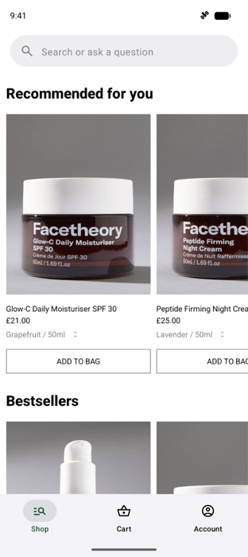

# App8Cloud for Android

App8Cloud is the Android SDK for the [App8](https://app8.dev) platform. It wraps
the [App8 engine](https://github.com/appeight/app8-android-sdk) (repository
`app8-android-sdk`, artifact `dev.app8:engine`) and adds everything needed to
deliver dynamic UI from the App8 API. It is the Android twin of
[`app8-ios-cloud-sdk`](https://github.com/appeight/app8-ios-cloud-sdk):

- A built-in `App8DataSource` that fetches DSL over `/sdk/v1/`.
- Token-based auth (`app8_live_…` / `app8_test_…`).
- An on-disk cache scoped per `(appId, screenId, version)`, and offline `.a8pack` bundles.
- Native fallbacks for resilience when a render fails.
- Host observability: subscribe to DSL `emit` action events, observe analytics
  events (auto-fired and author-declared), and override the active locale.
- Render telemetry callbacks.

If you need full control over how DSL is fetched (custom API, offline-only),
use the engine directly with your own `App8DataSource`.

> **Status: pre-1.0.** The API may change between `0.x` releases; breaking
> changes bump the minor version. SemVer guarantees begin at `1.0`.

| Offline launch (sample) | Offline shop (sample) |
|---|---|
|  |  |

## Requirements

- **Android 12 (API 31)+**, the floor shared with the engine; compileSdk 37.
- Kotlin 2.4, Jetpack Compose (the SDK renders with Compose; a `View` host is included).

## Installation

The SDK is published to GitHub Packages. Add the repository and the dependency:

```kotlin
// settings.gradle.kts
dependencyResolutionManagement {
    repositories {
        google()
        mavenCentral()
        maven("https://maven.pkg.github.com/appeight/app8-android-cloud-sdk") { credentials { /* GitHub user + token */ } }
        maven("https://maven.pkg.github.com/appeight/app8-android-sdk") { credentials { /* GitHub user + token */ } }
    }
}

// build.gradle.kts
dependencies {
    implementation("dev.app8:cloud:0.4.0")
}
```

`dev.app8:cloud:X.Y.Z` brings `dev.app8:engine:X.Y.Z` with it (an exact pin: one
release train).

## Quick start

Create one instance and keep it for the app's lifetime: it owns the cache, the
engine and the telemetry buffer. (This code is compiled in
[`sample/.../readme/QuickStart.kt`](sample/src/main/kotlin/dev/app8/cloud/sample/readme/QuickStart.kt).)

```kotlin
val cloud = App8Cloud.instance(
    context = applicationContext,
    token = "app8_live_abc123xyz",   // your App8 SDK token
    appId = "com.partner.flagship",  // your App8 app identifier
    environment = Environment.Custom("https://your-api.example.com/sdk/v1"),
)

// Optional: identity attributes for analytics dashboards.
cloud.setAttributes(mapOf("userId" to "u-42", "plan" to "free"))
```

Compose handles the async load for you: pass a `placeholder` and a `fallback`.

```kotlin
App8CloudScreen(
    instance = cloud,
    screenId = "home",
    placeholder = { CircularProgressIndicator() },
    fallback = { error -> NativeHome(error) },
)
```

`App8CloudApp(instance, …)` launches the whole app from `navigation.startFlow`.

Without the composables, `screen(...)` is a `suspend` function that never throws
in its fallback form; it returns `App8CloudContent` to draw with `Content()`:

```kotlin
val content = cloud.screen("home", version = null, parameters = emptyMap()) { error ->
    { NativeHome(error) }
}
// in composition:
content.Content(Modifier.fillMaxSize())
```

A throwing variant, `cloud.screen("home")`, throws `App8CloudError` if you'd
rather handle errors yourself. `flow(id)` renders a published flow;
`startApp()` the whole app.

Hosts without Compose use the View:

```kotlin
val view = App8CloudView(context).apply {
    instance = cloud
    fallbackFactory = { ctx, error -> NativeHomeView(ctx, error) }
    setScreen("home")
}
```

If the device is offline on first launch with nothing cached, the render fails
and your fallback is shown; once a screen is cached it renders without network.

## Preloading

The first `screen(...)` makes several sequential round-trips (manifest, styles,
components, screen). Warm the cache at launch so the first navigation is instant:

```kotlin
lifecycleScope.launch {
    cloud.prefetch()   // discovers and warms every screen + assets
}
```

`prefetch()` fetches the app manifest, styles, components, every published or
reachable screen, and the asset manifest. To warm specific screens only:

```kotlin
cloud.prefetch(listOf(PrefetchTarget("home"), PrefetchTarget("settings")))
```

Preloading is idempotent (cached entries short-circuit on `updatedAt` / content
hash), best-effort (per-screen failures don't abort the batch), and cancellable
with `cloud.cancelPrefetch()`. `onPrefetchCompleted` reports per-resource freshness.

## Screen availability

`cloud.availability("checkout")` answers `KNOWN`, `UNKNOWN` or
`CATALOG_NOT_LOADED` without a network call, from the screen catalog
(`GET /apps/{id}/screens`, persisted). Unknown ids fail fast with
`ScreenNotFound` while the catalog is fresh (`DiskCacheConfig.catalogTtl`).
`awaitCatalogReady(timeout)` waits for it; `refreshCatalog()` refreshes it.

## Offline bundles

An `.a8pack` is an on-device copy of a published flow or screen
([format](docs/OFFLINE_BUNDLE_FORMAT.md)). Ship packages in
`src/main/assets/App8OfflinePackages/<name>.a8pack/` (or download them into
`App8Cloud.defaultOfflinePackageDirectory(context, appId)`) and import them:

```kotlin
cloud.importBundledPackages()                 // APK assets + the download directory
cloud.importOfflineBundle(File(dir, "onboarding.a8pack"))
```

Importing seeds the disk cache; online, the normal freshness refresh layers on
top. `NetworkPolicy.OFFLINE_ONLY` serves exclusively from the cache. The
[sample](sample) renders a bundled `.a8pack` with no backend at all.

## Fonts

Fonts the content references are downloaded from the asset manifest (or
imported from a bundle) and handed to the engine as an `App8FontProvider`. Set
`cloud.fontProvider` for fonts your app ships; downloaded fonts take precedence.

## Events & analytics

`App8CloudInstance` exposes the engine's in-process buses directly.

### Action events (DSL `emit`)

```kotlin
val sub = cloud.subscribe("connect.tapped") { event ->
    MyAnalytics.track("connect_tapped", event.payload)
}
// sub.cancel() to stop.
```

`cloud.events` is a `SharedFlow` of the same events; `subscribeOnScreen(id)`
filters by screen; `setEventHandler { }` installs one replaceable handler.

### Analytics events

The engine auto-fires `app8.*` lifecycle events (`app8.screen.appeared`,
`app8.screen.dismissed`, `app8.component.tapped`, `app8.navigation.pushed`,
`app8.url.opened`). The cloud SDK adds four on the same bus:

- `app8.screen.rendered`: a `screen(...)` / `flow(...)` / `startApp(...)` render succeeded.
- `app8.render.failed`: a render failed.
- `app8.render.fallback`: the host fallback ran after a failure.
- `app8.screen.shortcircuit`: the catalog ruled the screen out without a round-trip.

```kotlin
cloud.observeAnalytics { event ->
    mixpanel.track(event.name, JSONObject(event.properties))
}
```

`event.properties` is the merged payload (`screen_id`, `engine_version`,
`cloud_version`, … as snake_case keys). `cloud.analytics` is the `SharedFlow`.
Tune auto-events with `cloud.analyticsConfig` (`autoScreenEvents`,
`autoComponentTaps`, `autoNavigationEvents`, `autoUrlEvents`, `autoCloudEvents`);
the four cloud events are gated by `autoCloudEvents`. Strip PII at the bus
boundary with `cloud.analyticsBus.redact`.

> **Privacy note.** Both buses are in-process. Nothing on them is sent to App8;
> that path is the separate, opt-out remote telemetry (`TelemetryPolicy.DISABLED`).

### Locale override

```kotlin
cloud.setLocale("fr-FR")
cloud.currentLocale   // "fr-FR"
cloud.setLocale(null) // back to the device locale
```

## Privacy & Play Store

- **Telemetry**: anonymous render/usage telemetry is sent by default. Pass
  `telemetry = TelemetryPolicy.DISABLED` to turn it off. The SDK mints no device identifier.
- **Identity**: only the attributes you pass to `setAttributes` are sent, for analytics.
- **Network**: requests carry `X-App8-SDK-Version`, `X-App8-DSL-Max`,
  `X-App8-Platform: android`, the host package name and version.
- **Token**: `app8_live_…` is a *publishable* client token embedded in your app;
  security comes from server-side scoping and rate limiting.
- **Dynamic UI**: don't ship new permissions or core functionality via DSL.

## Versioning

App8Cloud rides the App8 release train: `dev.app8:cloud:X.Y.Z` bundles
`dev.app8:engine:X.Y.Z` and matches iOS App8Cloud `X.Y.Z`. The version is
written once, in `SDKVersion.kt`.

## Support

Report bugs and ask integration questions via GitHub Issues on this repository.

## License

Apache 2.0, see [LICENSE](LICENSE) and [NOTICE](NOTICE).
